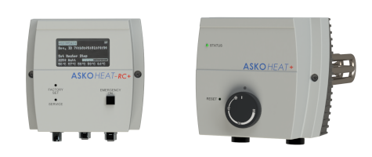
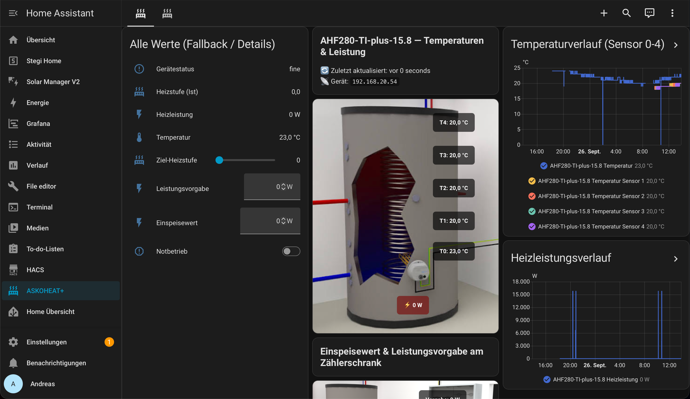
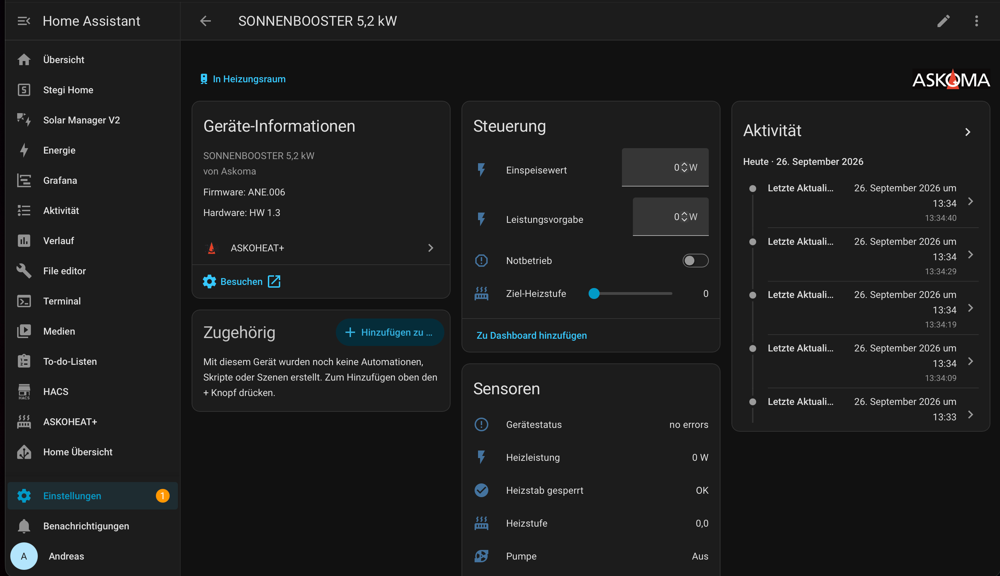
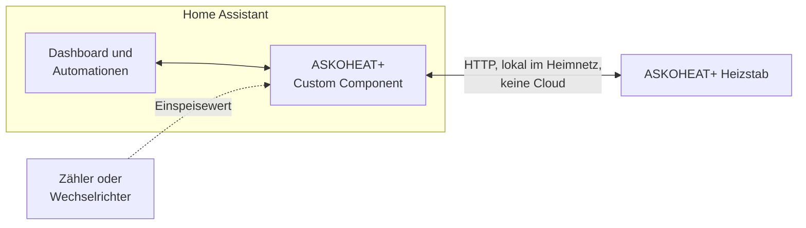

# ASKOHEAT+ für Home Assistant

Custom Integration für den [ASKOHEAT+](https://www.askoma.com) PV-Heizstab
(Hersteller Askoma). Sie spricht **lokal und ohne Cloud** direkt mit dem Gerät:
Werte lesen, steuern und alle Einstellungen der Geräte-Weboberfläche bequem in
Home Assistant bedienen.

*English summary: [below](#english-summary).*

## Was kann die Integration?

- **Lesen:** Temperaturen (Sensor 0–4), Heizleistung, Heizstufe, Status und
  Fehler des Geräts.
- **Steuern:** Heizstufe, Leistungsvorgabe, Einspeisewert und Notbetrieb. Das
  Gerät setzt gesendete Werte nach etwa 60 Sekunden zurück, die Integration
  sendet sie deshalb automatisch erneut (Keep-Alive).
- **Einspeisewert verknüpfen:** Den Einspeisewert oder die Leistungsvorgabe
  direkt mit einem Zähler- oder Wechselrichter-Sensor verbinden, ohne
  Automation. Die Quelle wählst du im Dashboard oder unter „⋮ → Konfigurieren“.
- **Temperatur-Funktionen einstellen:** Wärmepumpenanforderung,
  Minimaltemperatur, Niedertarif, Einspeisewert, Leistungsvorgabe, Heizstufe
  und Legionellenschutz, jeweils mit Schalter, Temperatur und Zeitfenster.
- **Fertiges Dashboard:** mit Bildern des Heizstabs, Live-Werten und
  Verlaufsgrafen, automatisch für jedes Gerät erzeugt.
- **Mehrere Geräte** gleichzeitig, Gerätefamilie (ASKOHEAT 2.0 oder Classic)
  wird automatisch erkannt.
- **Einstellungen neu laden** per Knopfdruck, wenn etwas direkt in der
  Geräte-Weboberfläche geändert wurde.

## So funktioniert es

> [!NOTE]
> Die Integration spricht per **HTTP** direkt mit dem Heizstab, nicht über Modbus und nicht über eine Cloud.
> Details und das ausführliche Diagramm: [`03_architektur.md`](custom_components/askoheat_plus/docs/de/03_architektur.md).

## Schnellstart (HACS)

1. In Home Assistant **HACS** öffnen und oben rechts über **⋮ →
   Benutzerdefinierte Repositories** diese Adresse eintragen, Kategorie
   **Integration**:
   `https://github.com/Andreas8476/AH-HomeAssistent-AddOn`
   (oder den Knopf oben benutzen).
2. **ASKOHEAT+** in HACS suchen, **Herunterladen** klicken und Home Assistant
   neu starten.
3. **Einstellungen → Geräte & Dienste → Integration hinzufügen → ASKOHEAT+**,
   die IP-Adresse des Heizstabs eingeben, fertig.

> [!TIP]
> Ohne HACS, HACS selbst installieren oder die Entwicklungs-Variante: siehe
> [Installation](custom_components/askoheat_plus/docs/de/04_installation.md).
> Neue Version verfügbar? HACS zeigt das Update unter **Einstellungen** an,
> siehe [Aktualisieren](custom_components/askoheat_plus/docs/de/13_aktualisieren.md).

## Getestet mit

- ASKOHEAT+ Flansch-Heizstab, 19 Stufen (AHF280-TI-plus-15.8, Firmware 5.3.an)
- OEM-Variante „SONNENBOOSTER“, Einschraub-Heizstab mit 7 Stufen, 5,2 kW

Rückmeldungen mit anderen Modellen sind willkommen, gern als
[Issue](https://github.com/Andreas8476/AH-HomeAssistent-AddOn/issues).

## Dokumentation

Vollständige, durchnummerierte Doku auf Deutsch (maßgeblich) unter
[`docs/de/`](custom_components/askoheat_plus/docs/de/), englische Übersetzung
unter [`docs/en/`](custom_components/askoheat_plus/docs/en/).

| Thema | Dokument |
|---|---|
| Überblick | [`01_ueberblick.md`](custom_components/askoheat_plus/docs/de/01_ueberblick.md) |
| Installation | [`04_installation.md`](custom_components/askoheat_plus/docs/de/04_installation.md) |
| Aktualisieren | [`13_aktualisieren.md`](custom_components/askoheat_plus/docs/de/13_aktualisieren.md) |
| Bedienung mit Screenshots | [`12_bedienung.md`](custom_components/askoheat_plus/docs/de/12_bedienung.md) |
| Alle Entities | [`05_entities.md`](custom_components/askoheat_plus/docs/de/05_entities.md) |
| Dashboard | [`11_dashboard.md`](custom_components/askoheat_plus/docs/de/11_dashboard.md) |
| Einspeisewert mit Zähler verknüpfen | [`10_automatisierung.md`](custom_components/askoheat_plus/docs/de/10_automatisierung.md) |
| Schnittstelle des Geräts (API) | [`02_api-referenz.md`](custom_components/askoheat_plus/docs/de/02_api-referenz.md) |
| Community & Verbreitung | [`14_community.md`](custom_components/askoheat_plus/docs/de/14_community.md) |

Änderungen je Version: [CHANGELOG.md](CHANGELOG.md).

## Hilfe und Fehler melden

- **Fehler und Wünsche:** als [Issue auf GitHub](https://github.com/Andreas8476/AH-HomeAssistent-AddOn/issues).
  Bitte Gerätemodell, Firmware-Version und die Version der Integration
  angeben.
- **Fragen und Austausch:** im [Beitrag im Home Assistant Forum](https://community.home-assistant.io/t/askoheat-askoma-pv-heating-element-custom-integration-local-no-cloud/1030960).

## English summary

Custom integration for the **ASKOHEAT+ PV heating element by Askoma**. It talks
to the device **locally, no cloud needed**.

- Read temperatures, heating power, heater step, status and errors
- Control heater step, load setpoint, feed-in value and emergency mode (with
  automatic keep-alive)
- Link the feed-in value or load setpoint to a meter/inverter sensor, no
  automation needed
- Configure all temperature functions of the device web UI (heat pump request,
  minimum temperature, low tariff, feed-in value, load setpoint, heater step,
  legionella protection)
- Ready-made dashboard with images and history graphs, several devices at once

**Install:** HACS → ⋮ → Custom repositories → add
`https://github.com/Andreas8476/AH-HomeAssistent-AddOn` as category
*Integration* → download **ASKOHEAT+** → restart Home Assistant → Settings →
Devices & services → Add integration → ASKOHEAT+ → enter the device IP.

Documentation in English:
[`docs/en/`](custom_components/askoheat_plus/docs/en/) (start with
[`01_overview.md`](custom_components/askoheat_plus/docs/en/01_overview.md)).
Bugs and wishes: [GitHub issues](https://github.com/Andreas8476/AH-HomeAssistent-AddOn/issues).

## Repositories

- **[GitLab](https://gitlab.com/SyberAlf/ah-homeassistent-addon)** — Haupt-Repo für die Entwicklung.
- **[GitHub](https://github.com/Andreas8476/AH-HomeAssistent-AddOn)** — öffentlicher Spiegel, nötig für die HACS-Installation (HACS unterstützt nur GitHub). Beide enthalten denselben Stand.

## Autor

Entwickelt von **Andreas Stegemann** in Zusammenarbeit mit **Claude**
(Anthropic, Modell Sonnet 5) als Coding-Assistent.

> [!NOTE]
> Andreas ist Mitarbeiter der **ASKOMA AG** (Bützberg, Schweiz), Hersteller des
> ASKOHEAT+ und weiterer Heizelemente/Thermostate für Trink- und Heizungswasser
> (u.a. Produktlinien ASKOHEAT+ und ASKOFAMILY+, [askoma.com](https://www.askoma.com)).
> Dieses Projekt ist jedoch ein **privates Projekt für den Eigengebrauch** und
> **keine offizielle Software der ASKOMA AG** — es basiert auf öffentlich
> zugänglicher Herstellerdokumentation der REST-Schnittstelle (und der Modbus-
> Registerdoku für die Status-Bits).

## Lizenz

MIT, siehe [LICENSE](LICENSE).
