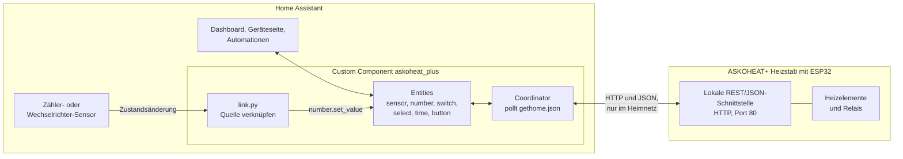
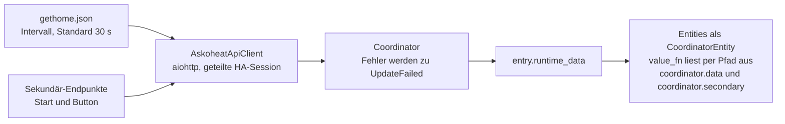
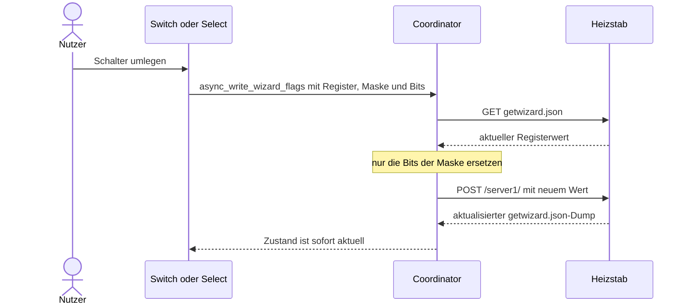

# 03 — Architektur

*[English version](../en/03_architecture.md)*

## Überblick: Wer spricht womit?



> [!NOTE]
> **Kein Modbus auf diesem Weg:** Die Integration spricht ausschließlich per **HTTP** mit dem
> Heizstab (lokale REST/JSON-Schnittstelle, unauthentifiziert, nur im Heimnetz). Namen wie
> `MODBUS_CMD_…` oder `MODBUS_CON_…` sind Schlüssel- bzw. Registerbezeichnungen innerhalb dieser
> HTTP-Schnittstelle. Der Heizstab bietet zusätzlich eine eigene Modbus-Schnittstelle (TCP/RTU)
> für andere Steuergeräte, die diese Integration **nicht** verwendet. Siehe
> [02_api-referenz.md](02_api-referenz.md) und [09_modbus-status-flags.md](09_modbus-status-flags.md).

## Ordnerstruktur

```
/homeassistant/askoheat_plus/                     # Repo-Root (eigenständiges Git-Repo)
  README.md  CHANGELOG.md  LICENSE  hacs.json  .gitignore
  .github/
    workflows/validate.yml                          # HACS-Action + hassfest (nur GitHub)
    ISSUE_TEMPLATE/                                 # Fehler-/Wunsch-Formulare (DE/EN)
  blueprints/
    askoheat_plus_feedin_from_meter.yaml            # Alternative zur eingebauten Verknüpfung
  custom_components/
    askoheat_plus/                                  # <- die eigentliche HA-Integration
      __init__.py  manifest.json  const.py
      api.py  coordinator.py  entity.py  config_flow.py  link.py
      sensor.py  binary_sensor.py  number.py  switch.py
      time.py  select.py  button.py
      translations/{de,en}.json
      brand/                                        # ASKOMA-Logo (icon/logo, HA 2026.3+ Konvention)
      product_pics/                                 # Produkt-/Screenshot-Bilder für README/Doku
      docs/
        de/                                         # <- diese Dokumentation (maßgeblich)
        en/                                         # englische Übersetzung
  dashboard/
    generate_dashboard.py                           # erzeugt das Dashboard pro Gerät
    askoheat_plus_dashboard.yaml                    # generiert, YAML-Mode Lovelace-Dashboard
    images/boiler-sensors.png  boiler-meter.png     # Andreas' Originalbilder

/homeassistant/custom_components/askoheat_plus       # Symlink -> ../askoheat_plus/custom_components/askoheat_plus
/homeassistant/www/askoheat_plus                     # ECHTE Kopie der Bilder (kein Symlink möglich, siehe 11_dashboard.md)
```

> [!NOTE]
> **Warum der Symlink:** Home Assistant lädt Custom Integrations ausschließlich aus
> `/homeassistant/custom_components/<domain>/`. Damit das Projekt trotzdem als ein
> einziger, eigenständiger Ordner existiert (der später 1:1 auf GitHub/GitLab
> gepusht werden kann, inkl. README/LICENSE/hacs.json auf Repo-Root-Ebene), liegt
> der tatsächliche Code unter `/homeassistant/askoheat_plus/custom_components/askoheat_plus/`
> und wird per Symlink nach `/homeassistant/custom_components/askoheat_plus`
> eingehängt. Kein Datei-Duplikat, eine Quelle der Wahrheit. Git wird nur im
> Ordner `/homeassistant/askoheat_plus/` initialisiert.

> [!WARNING]
> **Ausnahme Dashboard-Bilder:** Für `www/askoheat_plus` funktioniert derselbe
> Symlink-Trick **nicht** — Home Assistants `/local/`-Datei-Server folgt keinen
> Symlinks, die aus `www/` herauszeigen (Sicherheitsmaßnahme). Die Bilder
> liegen dort deshalb als echte, manuell synchronisierte Kopie. Details:
> [11_dashboard.md](11_dashboard.md).

## Modul-Verantwortlichkeiten

| Datei | Verantwortung |
|---|---|
| `const.py` | Domain, Default-Werte, Endpunkt-Namen, JSON-Pfad-Konstanten, Options-Flow-Schlüssel |
| `api.py` | `AskoheatApiClient` — reines HTTP/JSON, kein HA-Wissen: GET-Endpunkte, Inline-Commands, `POST /server1/` (`async_write_wizard`, mit einmaligem Retry bei "Server disconnected"). Hilfsfunktionen `get_path`, `extract_number`, `parse_active` |
| `coordinator.py` | `AskoheatDataUpdateCoordinator` — pollt `gethome.json` regelmäßig, lädt Sekundär-Endpunkte beim Start und auf Anforderung (`async_reload_secondary`), schreibt Bits gemeinsam genutzter Register per Read-Modify-Write (`async_write_wizard_flags`), baut `DeviceInfo` |
| `entity.py` | `AskoheatEntity` — gemeinsame Basisklasse (unique_id, device_info) |
| `config_flow.py` | UI-Setup (Host/Port/Intervall, Verbindungstest, `unique_id` = `DEVICEID`), Neu-Konfigurieren und Options-Flow für die Verknüpfung |
| `link.py` | Verknüpft optionale Quell-Entities (Options) mit den `number`-Entities Einspeisewert/Leistungsvorgabe über State-Listener und `number.set_value` |
| `sensor.py` / `binary_sensor.py` | Deklarative Entity-Beschreibungen (`AskoheatSensorEntityDescription` mit `value_fn` + `source`) |
| `number.py` | Steuerbare Werte: `SET_INPUTS.*` über Inline-Commands (mit Keep-Alive) sowie Installer-Einstellungen/Temperaturen über `POST /server1/` |
| `time.py` | Installer-Zeitfenster (Stunde/Minute-Felder als ein `time`-Wert) über `POST /server1/` |
| `switch.py` | Notbetrieb (parameterlose Befehle, kein Keep-Alive) sowie die "Aktiviert"-Schalter der Temperatur-Funktionen (einzelne Bits eines Registers) |
| `select.py` | Fühler-Auswahl und Legionellen-Intervall (Bit-Gruppen eines Registers) sowie die Quellen-Auswahl für Einspeisewert/Leistungsvorgabe (schreibt die Options des Config-Entry) |
| `button.py` | "Einstellungen neu laden" |
| `__init__.py` | `async_setup_entry`/`async_unload_entry`, verdrahtet Client → Coordinator → `entry.runtime_data` → Plattformen → Verknüpfungen, lädt bei Options-Änderung neu |

## Datenfluss



> [!CAUTION]
> **ESP32 schonen:** Das Gerät ist ein kleiner Mikrocontroller. Keine zusätzlichen Endpunkte
> leichtfertig in den regulären Poll (`_async_update_data`) aufnehmen, siehe
> [02_api-referenz.md](02_api-referenz.md), Abschnitt "Abfrage-Strategie".

## Schreib-Datenfluss

Drei Schreibwege, je nach Art des Werts:

```mermaid
flowchart TB
    subgraph W1["Weg 1: Inline-Commands mit Keep-Alive"]
        N1["number.py<br/>Heizstufe, Leistungsvorgabe,<br/>Einspeisewert"] --> C1["GET command mit value"]
        C1 --> R1["Refresh, der nächste Poll<br/>zeigt den Ist-Zustand"]
        N1 -.->|"alle 45 s, solange Wert ungleich 0"| C1
    end
    subgraph W2["Weg 2: Installer-Einstellungen mit eigenem Wert"]
        N2["number.py und time.py"] --> P2["POST /server1/"]
        P2 --> A2["Antwort ist der neue getwizard.json-Dump<br/>coordinator.secondary.wizard"]
    end
    subgraph W3["Weg 3: einzelne Bits gemeinsamer Register"]
        N3["switch.py und select.py"] --> F3["async_write_wizard_flags"]
        F3 --> G3["frisches getwizard.json laden"]
        G3 --> M3["nur die Bits der Maske ändern"]
        M3 --> P3["POST /server1/<br/>nur bei Änderung"]
    end
```



Ablauf von Weg 3 am Beispiel eines Schalters:



Kein separater Schreib-Coordinator, keine Bestätigungsabfrage. Fehler beim
Schreiben werden als `HomeAssistantError` an die UI durchgereicht (z.B.
Gerät nicht erreichbar).

> [!IMPORTANT]
> **Keep-Alive (nur Weg 1):** solange ein gesetzter Wert `≠ 0` ist, hält jede
> Number-Entity zusätzlich einen eigenen `async_track_time_interval`-Timer (alle
> 45s), der denselben Befehl erneut sendet — verhindert den vom Hersteller
> dokumentierten 60s-Auto-Verfall. Timer lebt pro Entity-Instanz
> (`_unsub_keepalive`), wird bei `0` oder `async_will_remove_from_hass`
> gestoppt. Die Wege 2 und 3 verfallen nicht, dort ist kein Keep-Alive nötig.
> Details: [02_api-referenz.md](02_api-referenz.md).

## HA-Konventionen, die bewusst verwendet werden

- **`entry.runtime_data`** (statt `hass.data[DOMAIN][entry_id]`) — aktuelle
  Empfehlung für HA-Versionen ab 2024.7, entspricht dem hier installierten
  2026.10.4. Typisiert über `type AskoheatConfigEntry = ConfigEntry[AskoheatDataUpdateCoordinator]`
  in `__init__.py`.
- **`async_get_clientsession(hass)`** statt eigenem `aiohttp.ClientSession()` —
  nutzt die von HA verwaltete, geteilte Session (kein manuelles Schließen nötig).
- **`CoordinatorEntity`** + zentrale `DeviceInfo` auf dem Coordinator (nicht pro
  Entity dupliziert) — ein Muster, das sich bereits bei `goecharger_api2` bewährt.
- **Dataclass-`EntityDescription`-Listen** statt einer Klasse pro Sensor — kompakt,
  leicht erweiterbar (neue Sensoren, `number`/`select`/`switch`/`time`/`button` für Schreibzugriff).

## Warum kein Multi-Coordinator-Setup

Die Sekundär-Endpunkte hätten in eigenen, langsameren Coordinators leben
können. Entschieden wurde (auf Andreas' Wunsch) bewusst einfacher: ein
Coordinator, die Sekundär-Endpunkte laden beim Start und auf Knopfdruck
(Button "Einstellungen neu laden"), kein automatisches Intervall. Das schont
den ESP32 und reicht aus, weil Änderungen über Home Assistant ohnehin sofort
übernommen werden. Sollte sich später ein automatisches Nachladen als nötig
erweisen, wäre ein zweiter `DataUpdateCoordinator` mit
`update_interval=timedelta(minutes=30)` ein lokal begrenzter Umbau in
`coordinator.py`.

