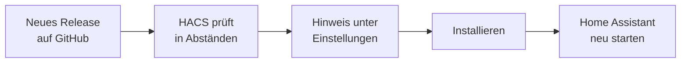

# 13 — AddOn aktualisieren

*[English version](../en/13_updating.md)*

Wie man ASKOHEAT+ auf eine neue Version bringt, sobald auf
[GitHub](https://github.com/Andreas8476/AH-HomeAssistent-AddOn/releases) ein
neues Release erscheint. Welche Variante gilt, hängt davon ab, wie die
Integration installiert wurde (siehe [04_installation.md](04_installation.md)).

> [!NOTE]
> Bei einem Update bleiben Einrichtung, Entitäten, Verlauf,
> Dashboard und Optionen (z.B. die Einspeisewert-Verknüpfung) erhalten. Die
> Einstellungen am Gerät selbst sind davon ohnehin nicht betroffen.

## Variante A: Installation über HACS (empfohlen)

HACS hat bereits einen eingebauten Update-Mechanismus, es ist nichts extra
einzurichten. HACS prüft regelmäßig, ob es auf GitHub ein neues Release gibt.



### So sieht man, dass ein Update verfügbar ist

- **Einstellungen** (Seitenleiste) zeigt oben einen Eintrag
  **"ASKOHEAT+ update"**, genau wie bei Updates von Home Assistant selbst.
- Alternativ: **HACS** öffnen → bei **ASKOHEAT+** steht ein Update-Hinweis
  mit der neuen Versionsnummer.

### Update installieren

1. Auf den Eintrag **"ASKOHEAT+ update"** klicken.
2. Optional **"Versionshinweise"** lesen (was sich geändert hat, siehe auch
   [CHANGELOG.md](../../../../CHANGELOG.md)).
3. **Installieren** klicken.
4. Home Assistant **neu starten**, wenn danach gefragt wird
   (**Einstellungen → System → ⏻ oben rechts → Home Assistant neu starten**).
   Erst nach dem Neustart läuft die neue Version.

### Update erscheint nicht?

- HACS prüft nicht sofort, sondern in Abständen. Manuell anstoßen: **HACS**
  → bei **ASKOHEAT+** die drei Punkte (⋮) → **"Informationen aktualisieren"**
  ("Update information").
- Eine bestimmte (auch ältere) Version installieren: **HACS** →
  **ASKOHEAT+** → ⋮ → **"Erneut herunterladen"** ("Redownload") → Version
  auswählen → danach neu starten. Praktisch, falls eine neue Version Probleme
  macht und man zurück möchte.

## Variante B: Manuelle Installation (ohne HACS)

Hier gibt es keine automatische Benachrichtigung — auf der
[Releases-Seite](https://github.com/Andreas8476/AH-HomeAssistent-AddOn/releases)
nachsehen, ob es eine neue Version gibt (Tipp: auf GitHub oben rechts
**Watch → Custom → Releases** aktivieren, dann kommt eine E-Mail).

1. Beim neuen Release unter **Assets** den **Source code (zip)** herunterladen
   und entpacken.
2. Den Ordner `custom_components/askoheat_plus/` aus dem ZIP nehmen und den
   bestehenden Ordner `/config/custom_components/askoheat_plus/` damit
   **komplett ersetzen** (vorher löschen, nicht nur drüberkopieren, damit
   keine veralteten Dateien übrig bleiben).
3. Home Assistant neu starten.

Wer manuell installiert hat und künftig bequem updaten will: einfach auf
Variante A (HACS) umsteigen — den manuell kopierten Ordner löschen, dann wie
in [04_installation.md](04_installation.md) beschrieben über HACS
installieren. Die Einrichtung in Home Assistant bleibt dabei erhalten.

## Variante C: Entwicklungs-Setup (Git-Klon + Symlink)

Nur für die Entwicklung (siehe [06_entwicklung.md](06_entwicklung.md)): hier
läuft immer direkt der Stand des lokalen Git-Repos.

```bash
cd /config/askoheat_plus
git pull
ha core restart
```

## Welche Version läuft gerade?

- **Version der Integration (dieses AddOn):** in **HACS** bei **ASKOHEAT+**.
- **Firmware des Heizstabs:** **Einstellungen → Geräte & Dienste →
  ASKOHEAT+** → Gerät öffnen → Zeile "Firmware".

Beides nicht verwechseln: Die Firmware des Geräts wird über die
Geräte-Weboberfläche bzw. vom Hersteller aktualisiert, nicht über HACS.

## Für die Entwickler: neue Version veröffentlichen

> [!IMPORTANT]
> Damit HACS-Nutzer ein Update überhaupt angezeigt bekommen, muss jede neue
> Version auf GitHub als **Release** veröffentlicht werden — ein Git-Tag allein
> reicht nicht, HACS wertet die Releases aus.

1. Version in `custom_components/askoheat_plus/manifest.json` hochzählen
   (Semantic Versioning, z.B. `0.8.0` → `0.9.0`).
2. [CHANGELOG.md](../../../../CHANGELOG.md) ergänzen
   (`[Unreleased]` → neue Versionsnummer + Datum).
3. Commit, Tag `vX.Y.Z` setzen, **beides auf GitLab und GitHub pushen**
   (`git push origin main --tags` und `git push github main --tags`).
4. Auf GitHub unter **Releases → Draft a new release** den Tag auswählen,
   als Text den passenden CHANGELOG-Abschnitt einfügen, **Publish release**.
