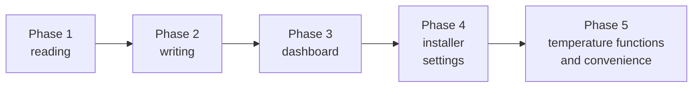

# 01 — Overview

*[Deutsche Version](../de/01_ueberblick.md) (primary, authoritative)*

## Goal

A Home Assistant integration for the **ASKOHEAT+** PV heating element
(manufacturer [Askoma](https://www.askoma.com)) that reads and controls
its local, unauthenticated REST API on the home network — including the
settings of the device's web UI.

## Why a custom integration instead of an add-on

ASKOHEAT+ speaks a simple local REST/JSON API (no MQTT, no cloud dependency).
A dedicated **custom integration**
(`custom_components/askoheat_plus/`), installable via HACS/GitHub, is the
idiomatic way to do this — it runs directly inside the Home Assistant
process, creates native entities, and needs no separate Docker container.
Two integrations already present in the same Home Assistant setup solve
structurally the same problem (local device, polling, config flow) and
served as a model:

- [`goecharger_api2`](https://github.com/marq24/ha-goecharger-api2) — go-eCharger EV charger
- [`froeling_lambdatronic_modbus`](https://github.com/GyroGearl00se/ha_froeling_lambdatronic_modbus) — pellet heating system

## Phases

The project was deliberately built in steps, all of them are implemented:

1. **Phase 1 — reading:** sensors/binary sensors for the device's current
   state (heater step, power, temperature, status, errors).
2. **Phase 2 — writing:** set heater step, load setpoint and feed-in value
   via the manufacturer-documented inline commands, as `number` entities
   (with keep-alive), plus the emergency-mode switch.
3. **Phase 3 — dashboard:** a dedicated Lovelace dashboard with Andreas'
   Askoma renders as the background and live values as an overlay.
4. **Phase 4 — installer settings:** writable `number`/`time` entities for
   legionella protection, low tariff, feed-in window, heat pump request etc.
   via `POST /server1/`.
5. **Phase 5 — temperature functions & convenience:** all temperature
   functions of the device web UI (switches, temperatures, sensor, legionella
   interval), source selection for feed-in value/load setpoint directly in
   the dashboard and the "Reload settings" button.

## Current status

Current version: **0.10.1** (see [CHANGELOG.md](../../../../CHANGELOG.md)).

- [x] Reading: sensor/binary sensor entities, config flow via the UI, polling
      of `gethome.json`, secondary endpoints at startup and via button.
- [x] Controlling: `number` entities (target heater step, load setpoint,
      feed-in value) with keep-alive against the 60s expiry, emergency-mode
      switch, linking to a meter/inverter via the options flow, dashboard
      selection or blueprint, see [05_entities.md](05_entities.md) and
      [10_automation.md](10_automation.md).
- [x] Installer settings and temperature functions: writable
      `number`/`time`/`switch`/`select` entities, see
      [05_entities.md](05_entities.md).
- [x] Dashboard: YAML Lovelace dashboard per device with image cards,
      history graphs and the "Temperatur-Funktionen" card, see
      [11_dashboard.md](11_dashboard.md).
- [x] Updating and community: [13_updating.md](13_updating.md),
      [14_community.md](14_community.md).

## Test environment

Local test device on Andreas' home network: `192.168.20.54` (the host is
freely configurable in the integration, not hardcoded).

## Further documents

See [docs/en/](.) — numbered, `02` starts with the API reference. German
original in parallel under [docs/de/](../de/) — German is the primary,
authoritative version; this translation may occasionally lag behind it.

## Author

> [!NOTE]
> Developed by Andreas Stegemann in collaboration with Claude (Anthropic,
> Sonnet 5) as a coding assistant. A private project, not official ASKOMA AG
> software — details see [README.md](../../../../README.md#autor).
> 