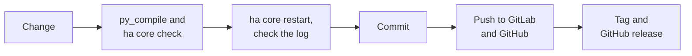

# 06 — Development

*[Deutsche Version](../de/06_entwicklung.md) (primary, authoritative)*

> [!IMPORTANT]
> **MANDATORY RULE: every commit goes to BOTH remotes — GitLab
> (`origin`) AND GitHub (`github`).** Never push to only one of the two.
> Reason: GitLab is the main repo, GitHub is strictly required for HACS to
> work (HACS only installs from public GitHub repos). See the "Two git
> remotes" section below for the exact commands.

## Where the code lives

- Repo root: `/homeassistant/askoheat_plus/`
- Loaded integration: `/homeassistant/custom_components/askoheat_plus`
  (symlink, see [03_architecture.md](03_architecture.md))
- Test device on the local network: `192.168.20.54` (freely choosable at
  setup)

## Common commands

```sh
python3 -m py_compile /homeassistant/askoheat_plus/custom_components/askoheat_plus/*.py
ha core check                 # validate the configuration — always before restart
ha core restart                # restart HA core (needed after code changes)
ha core logs | grep -i askoheat   # check for errors/tracebacks
```

Important: on this host, `homeassistant` exists as a namespace directory in
`sys.path`, but is **not** a real, importable package — so a
`python3 -c "import custom_components.askoheat_plus"` fails even if the code
is correct. Real load errors only show up via `ha core restart` +
`ha core logs`. `py_compile` only catches plain syntax errors.

## After every code change

1. `python3 -m py_compile ...` (syntax)
2. `ha core check`
3. `ha core restart`
4. `ha core logs | grep -i askoheat` — specifically look for
   tracebacks/`ERROR`
5. If a config entry already exists: check whether the entities in the UI
   still deliver values (not "unavailable")

## Verifying against the test device

```sh
curl -s http://192.168.20.54/gethome.json | python3 -m json.tool | head -50
```

This lets you check, independently of Home Assistant, whether the device is
reachable and which fields it currently delivers — useful for matching
`value_fn`/paths in `sensor.py`/`binary_sensor.py` against real data before
doing an HA restart.

## Two git remotes: GitLab (`origin`) + GitHub (`github`)

```sh
git push origin main     # main repo (GitLab)
git push github main     # public mirror for HACS (GitHub)
git push origin <tag>
git push github <tag>
```

Both should always be at the same state — push to **both** remotes after
every `commit`. Reason: HACS only installs from public GitHub repos, see
[04_installation.md](04_installation.md).

## Pitfalls

- **Don't break the symlink:** `/homeassistant/custom_components/askoheat_plus`
  is a symlink. Don't accidentally resolve it into a real copy with
  `cp`/editors — that would make the repo and the loaded integration
  diverge.
- **Keep translations bilingual:** new `translation_key`s (in `sensor.py`, `number.py`, `switch.py`,
  `select.py`, `time.py`, `button.py` etc.) need a matching entry in **both**
  `translations/de.json` and `translations/en.json`, otherwise HA shows the
  raw key instead of a readable name.
- **Protect the ESP32:** don't casually add extra endpoints to the regular
  coordinator cycle (`_async_update_data`) — see
  [02_api-reference.md](02_api-reference.md), section "Polling strategy".
- **Code comments/docstrings in German:** regardless of the documentation
  language (see [01_overview.md](01_overview.md)), comments and docstrings
  throughout the Python code are written in German.

## Publishing a new version

The path from a change to a release:



Bump the version in `manifest.json`, finish `CHANGELOG.md`, set the tag, push
to **both** remotes and publish a release on GitHub — the complete procedure
is in [13_updating.md](13_updating.md) (section "For developers"). The
validation runs (HACS action, hassfest) run automatically via
`.github/workflows/validate.yml`.

> [!NOTE]
> Home Assistant reads the version number from `manifest.json` only
> at startup. After bumping it (and after every code change) an
> `ha core restart` is needed, otherwise the UI still shows the old version.
> 